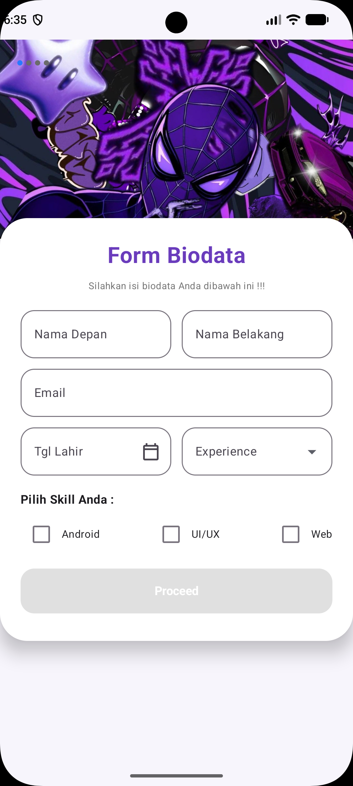
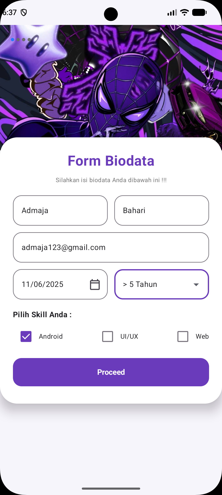
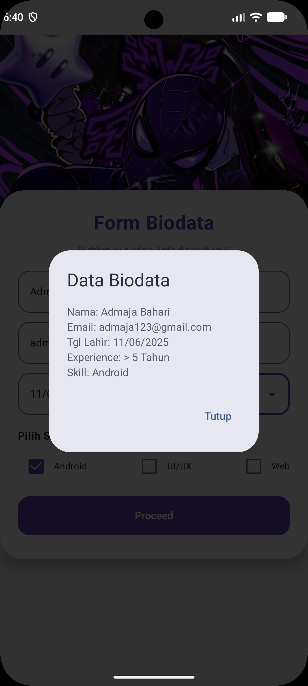

# QuestTugasUserInput_0052

Tugas Pemrograman Android: **User Input** menggunakan Jetpack Compose.

## Deskripsi

Aplikasi Form Biodata yang menerima input pengguna berupa nama depan, nama belakang, email, tanggal lahir, experience, dan skill. Tombol **Proceed** baru aktif setelah semua data terisi.

## Fitur

- Input nama depan dan nama belakang
- Input email
- Pemilihan tanggal lahir dengan Date Picker
- Dropdown experience
- Checkbox skill (Android, UI/UX, Web)
- Tombol Proceed dengan validasi form
- Dialog hasil input

## Ketentuan Tugas

- Semua warna, gambar, dan teks disimpan di Resources
- Komponen Box mengapung di atas Scaffold
- Tidak ada hardcode
- Layout menggunakan Jetpack Compose

## Teknologi

- Kotlin
- Jetpack Compose
- Material 3

## Hasil Running

### Form kosong

Tombol Proceed nonaktif (abu-abu) selama form belum lengkap.

### Form terisi

Tombol Proceed aktif (ungu) setelah semua field terisi dan minimal satu skill dipilih.

### Dialog hasil

Dialog menampilkan data yang diinput setelah tombol Proceed ditekan.

## Identitas

- Nama: Admaja Bahari
- NIM: 20230140052
- Kelas: C
- Program Studi: Teknologi Informasi, Universitas Muhammadiyah Yogyakarta